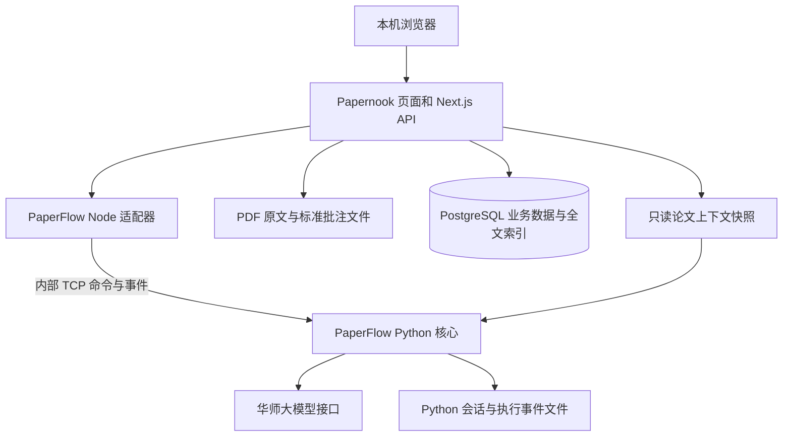

# 论文研究 Web 应用 Demo 实施计划

以 Papernook 为产品主体，接入 PaperFlow 分析核心，交付供本人在 Windows 本机浏览器使用的论文研究工作台。首版贯通导入论文、阅读批注、AI 分析、独立笔记、知识图谱及导出，数据保存到本机，模型沿用华师大接口。

计划日期为 2026-10-31。需求基线是此前的[一体化 Web 应用方案](C:/Users/36921/Documents/Codex/2026-10-13/qin/outputs/Papernook与PaperFlow一体化Web应用方案.md)，此次增加可追溯的语义知识图谱。当前交付阶段为实施计划，尚未开始本轮 Demo 开发。

## 部署费用约束

部署采用本机计算、本机 PostgreSQL 和 PDF 文件存储，不购买云主机、托管数据库、对象存储或域名，不启用云构建、付费试用及自动续费服务。数据库方案于 2026-11-08 更新为 PostgreSQL。Papernook 主仓库采用 MIT 许可证，可免费自托管和修改，保留许可声明。[项目许可证](https://github.com/affromero/papernook/blob/4f36454eb73f85450882d35519aa41701aca5b39/LICENSE)

Docker Desktop 的个人使用属于免费范围，只使用本地构建和运行，不启用 Docker 付费云服务。[Docker 官方许可说明](https://docs.docker.com/subscription-billing/desktop-license/) 可选 tldraw Canvas 继续关闭，图谱沿用 Cytoscape。

模型调用使用现有华师大额度，可用于真实分析、提取和验收。官方按 credits 配额限制调用，具体以账号实际额度为准。[华师大配额说明](https://developer.ecnu.edu.cn/vitepress/llm/limit.html) 额度不足时停止并提示，不自动充值，不切换到其他收费模型，也不因限额无限重试。依赖安装和应用启动不隐式触发外部模型调用；导入默认只做本地抽取，AI 分类、摘要与图谱生成由用户明确触发。未经另行授权不新增付费服务。

## 产品形态和页面

应用采用中文导航、文献库列表和可调整的阅读工作区。常用阅读布局为中间 PDF、右侧 AI 与笔记；知识图谱有独立页面，查看关系时可打开来源面板并返回阅读位置。

| 页面 | 首版可操作内容 |
| --- | --- |
| 文献库 | 上传 PDF、查看和修改元数据、主题与标签、搜索、阅读状态、进入论文 |
| 阅读工作台 | PDF 翻页、缩放、文内搜索、高亮、中文评论、选区提问、阅读位置恢复 |
| 分析面板 | 流式聊天、结构化论文分析、来源引用、执行进度、取消、失败重试 |
| 笔记中心 | 手动编辑笔记、AI 笔记草稿、Markdown 编辑和预览、标签、版本、原文回跳 |
| 知识图谱 | 文献关系与研究知识两种视图、筛选、搜索、邻居展开、证据查看和导出 |
| 任务与设置 | 分析历史、待处理动作、模型配置、连通性检查、服务状态、备份恢复 |

一条完整使用流程为：导入论文 → 打开 PDF → 选中段落分析 → 保存或编辑笔记 → 确认中文原文评论 → 生成知识图谱 → 查看关系证据 → 回到原文 → 导出成果。关闭并重新启动后，文献、笔记、已完成任务与图谱仍可恢复。

## 首版实现范围

### 论文管理与阅读

- 支持上传带文字层的 PDF，保留原始文件及可恢复副本；录入标题、作者、年份、DOI、主题、标签。
- 提取按页组织的正文，建立可搜索分块；缺少文字层时明确提示，避免产生无来源分析。
- 沿用 Papernook 阅读器与版本保护，支持手动高亮、中文评论和带批注 PDF 导出。
- 选区保存文档身份、页码、引用文字和位置；笔记、答案及图谱证据可返回来源。
- 对重复导入、上传失败、正文替换和保存冲突给出可操作反馈。

### PaperFlow 分析

- 选区解释、方法解读、局限讨论和自由提问，回答引用当前论文的页码与证据片段。
- 一键生成结构化精读结果：研究问题、方法、数据或实验、主要结果、贡献、局限、可继续追问的问题。原文未提供的信息标记为未找到。
- 分析结果可保存为笔记草稿或送入图谱提取；模型输出经结构校验和来源核对后入库。
- 任务显示排队、运行、等待确认、完成、失败、取消和中断状态；支持取消及显式重试。
- 限制单次上下文，使用分块检索和分段分析处理长论文；已完成的有效中间结果可复用。

### 论文笔记

- 每篇论文可有多条独立笔记，不覆盖现有论文摘要。
- 支持手动创建、编辑 AI 草稿、Markdown 预览、标签、来源链接和版本记录。
- AI 修改已有笔记先产生可比较的新版本，保留人工编辑。
- 保存为网页笔记与写入 PDF 评论分开呈现；PDF 写入前显示目标位置和待写内容，确认后提交。
- 支持按论文导出 Markdown 笔记及来源清单。

### 知识图谱

Papernook 已有论文、作者、主题、标签节点，以及作者、归类、标签、相关论文和引用关系。本项目复用其图谱接口和可视化组件，扩展研究知识视图。[现有图谱数据](https://github.com/affromero/papernook/blob/4f36454eb73f85450882d35519aa41701aca5b39/src/lib/library/graph.ts) · [图谱组件](https://github.com/affromero/papernook/blob/4f36454eb73f85450882d35519aa41701aca5b39/src/components/graph/LibraryGraph.tsx)

新增节点以概念、方法、论文报告的结论和笔记为主，关系限定为论文讨论概念、采用方法、报告结论、笔记来源于论文及人工关联。跨论文共享概念可汇总为同一节点，中文英文别名先形成合并候选，由用户核对。

图谱支持节点类型与论文范围筛选、搜索、拖动缩放、邻居展开、关系来源面板，以及 JSON 数据和图片导出。点击语义关系可查看原文证据并返回相应页面。

每条 AI 语义关系保存来源论文、正文版本、页码或选区、原文摘录、分析任务和确认状态。模型生成内容先作为候选，可确认、编辑、合并或拒绝。元数据关系标明元数据来源；标题匹配推测的引用关系与精确标识匹配有所区分。不会仅凭概念共现生成支持、反驳或因果关系。

首版展示多篇论文的共享概念与研究关系；自动跨论文综述、大规模文献 RAG、全文 OCR、视觉图表理解、多人协作和公网发布作为后续扩展。图谱使用 Cytoscape，不依赖可选的 tldraw Canvas。

## 技术架构



| 部分 | 计划采用的技术及作用 |
| --- | --- |
| 网页与服务端 | 固定 Papernook 0.4.0 基线的 Next.js 16.4.3、React 19.3.1、TypeScript 及依赖锁文件，统一中文工作台 |
| PDF | 复用 PDF.js 阅读与标注、现有标准 PDF Text 评论通道及版本化保存 |
| 分析核心 | Python 3.12、现有 PaperFlow Agent、专用论文工具与持久会话 |
| 服务连接 | Next.js Node runtime 内使用 TCP 客户端，避免增加独立 HTTP 网关 |
| 任务推送 | SSE 传递文本、工具状态、确认请求与最终结果；操作通过认证 API 提交 |
| 图谱 | 现有 Cytoscape.js 与 fCoSE 布局，扩展节点、关系和证据面板 |
| 数据 | PostgreSQL 保存论文信息、页正文、笔记及版本、批注记录、概念、图谱、复习、待办和网页研究任务；GIN 全文索引结合相关度排序及中英文原文匹配。PDF 保留文件，Python 会话与事件保留 runtime 文件 |
| 校验 | 服务端校验任务归属、选区版本和模型输出结构，跨语言协议提供契约测试 |
| 交付 | Docker Compose 两服务、Windows 启停脚本；原生开发方式以本地依赖验证结果为准 |
| 验证 | 沿用 Vitest、pytest 与 Playwright，覆盖接口、任务和真实浏览器主流程 |

Web 基线技术版本与依赖以固定提交的 [package.json](https://github.com/affromero/papernook/blob/4f36454eb73f85450882d35519aa41701aca5b39/package.json) 为准。

首版不额外依赖 Neo4j、Redis、独立向量数据库或本地推理 GPU。查询先复用 Papernook 的分块全文检索；以后确需语义召回时，再接入经过验证的 embedding 服务。

Papernook 源码基线候选固定为 `4f36454eb73f85450882d35519aa41701aca5b39`，先通过构建与关键保存检查后纳入整合。PaperFlow 保留本地 `500baf5a404f6f00133a3280b2cf40d178c63cf7` 基线和已有数据目录、启动、密钥日志修正。主仓库许可声明和上游来源随源码保留。

## 必须完成的接入改造

### 统一聊天事件和任务管理

Papernook 现有 provider 流接口只返回字符串，PaperFlow 接入还需要配置类型、就绪检查和聊天事件扩展。保留旧接口供后台一次性任务使用，为阅读聊天增加结构化事件通道。[现有 provider 契约](https://github.com/affromero/papernook/blob/4f36454eb73f85450882d35519aa41701aca5b39/src/lib/agent/types.ts)

PaperFlow 增加立即返回任务 ID 的异步启动、真正取消、会话按需加载和中断恢复。每个聊天绑定独立会话，每个任务绑定文档及正文版本；正文、历史和工具事件不能串入另一篇论文。会话和最终结果可靠落盘后才发送完成通知。[当前会话实现](https://github.com/weijian-ai/PaperFlow/blob/500baf5a404f6f00133a3280b2cf40d178c63cf7/src/paperflow/core/session/manager.py)

Node 客户端区分命令回复与订阅事件，提供断线重连、事件序号和结果去重。浏览器断开不等于用户取消；显式取消会停止模型流、待确认及尚未提交的动作。已经提交的保存如实显示，重启不自动重放写入。

### 中文批注和保存

新版 Papernook 已有 Unicode Text 评论通道，应优先让 AI 中文批注接入此通道。旧的聊天答案转 FreeText 边注仍有字符过滤限制；两者不能混用为同一种能力。页边显示整段中文文本框需要另外处理字体外观，不作为首版必需条件。[Unicode 评论写入](https://github.com/affromero/papernook/blob/4f36454eb73f85450882d35519aa41701aca5b39/src/lib/library/pdf/comments.ts#L94)

每条批注由阅读器或来源解析器提供可信位置；模型只引用已有选区或证据 ID。批注创建、笔记保存和内容更新都由 Papernook 服务提交，Python 不直接覆盖 PDF。保留文件锁、ETag 比对和原子替换；保存成功后更新状态并返回实际版本。

### 文档与图谱的一致性

- 文档使用持久 UUID，路径和 PDF 哈希仅用于位置与去重。
- 正文及页面布局版本与 PDF 保存 ETag 分开；增加批注不应使所有正文引用失效。
- 笔记、聊天消息、分析、节点和关系具有稳定 ID，写操作有唯一动作 ID。
- 图谱生成结果与抽取版本分别保存；重跑更新候选，不重复追加，也不自动恢复被拒绝关系。
- 正文替换后将旧证据标记为待重定位，保留历史及人工笔记，避免沿用错误坐标。
- 文件写入使用临时文件、原子替换与动作恢复日志；写成功但回包丢失时，重试返回已有结果。
- 搜索和关系查询索引可从原始文件重建；备份必须包含原文、笔记、图谱证据、会话绑定及动作记录。

分析工具只获得当前文档的只读上下文和专用操作，不注册任意路径写入或 shell。模型凭据由服务端读取，网页只显示脱敏状态。用户点击生成或分析时保存对应草稿；修改人工内容及向 PDF 写入采用明确的内容确认。

## 所需环境与本机预检

主路径采用 Docker Compose 管理网页与 PaperFlow 两个服务，保持上游 Node 22 Bookworm 基础环境。Windows 启动脚本负责检查引擎并打开网页。备用原生开发方式需要先验证本地依赖，不把当前内置 Node 可运行等同于整个 Web 项目可运行。

| 环境 | 用途与目标 | 2026 年 10 月 31 日预检结果 |
| --- | --- | --- |
| Windows 与现代浏览器 | 本机访问，Edge 或 Chrome 验证 | 沿用当前电脑；浏览器完整流程在开发阶段验证 |
| Node.js 22 LTS 和 npm | 与上游 Docker 一致；原生开发需要独立工具链 | 当前有 Codex 内置 Node 24.19.0 和 pnpm 11.25.0；未找到 npm，不依赖私有工具路径交付 |
| Python 3.12 与 uv | PaperFlow 原生运行和测试 | Python 3.12.10、uv 0.11.8 可用 |
| Docker Desktop 和 Compose | 推荐的一键交付方式 | Docker CLI 29.8.2、Compose 5.5.1 可用，引擎当前不可连接；需要恢复并核验 |
| WSL2 | Docker Linux 容器环境 | 状态查询返回访问拒绝，尚不能确认状态 |
| PDF 系统工具及字体 | Poppler、qpdf、Ghostscript 等用于抽取和 PDF 处理 | 随容器镜像安装；原生运行另列依赖并检查路径 |
| 华师大模型配置 | 分析、提取和图谱生成 | 沿用现有接口和 ecnu-max 配置，开工阶段复测可用性 |

Node 22 处于官方 LTS 支持范围。[Node.js 版本说明](https://nodejs.org/en/about/previous-releases) Papernook 包含 better-sqlite3 和文件锁原生模块，不能只按普通前端项目安装；原生 Windows 方案须验证编译与平台兼容性，必要时使用 WSL2。容器中一并安装 PDF 系统依赖。[上游构建环境](https://github.com/affromero/papernook/blob/4f36454eb73f85450882d35519aa41701aca5b39/Dockerfile) PaperFlow 当前项目限定 Python `>=3.12,<3.13`，因此不直接换到其他 Python 次版本。[项目依赖定义](https://github.com/weijian-ai/PaperFlow/blob/500baf5a404f6f00133a3280b2cf40d178c63cf7/pyproject.toml)

工程资源建议为 16 GB 内存、约 20 GB 可用磁盘以容纳依赖和容器镜像，另预留论文存储空间；这是开发配置建议，不是已测出的最低门槛。模型远程调用，无需本机 GPU。

华师大接口使用 `https://chat.ecnu.edu.cn/open/api/v1`。10 月 15 日已有部署验证记录，但本轮计划阶段不调用收费模型，不据此宣称 10 月 31 日凭据仍有效。应用和数据在本机，发送给模型的论文片段仍会经过该接口。

网页只发布在 `127.0.0.1:3000`，端口被占用时由启动器明确显示调整地址。容器内 PaperFlow 设置 `PAPERFLOW_HOST=0.0.0.0`、`PAPERFLOW_PORT=7437`，仅供 Compose 内部网络按服务名访问，不发布宿主端口；原生开发使用独立本地端口及数据目录，避开已有 PaperFlow 服务。

## 开发阶段与验收

| 阶段 | 主要实现 | 阶段通过条件 |
| --- | --- | --- |
| 1 环境与基线 | 工具链、独立项目、依赖锁定、服务启动、现有配置迁移、使用现有额度检查连接 | 网页与分析核心可重复启动；额度范围内模型健康检查真实通过；不影响原部署 |
| 2 阅读与资料库 | 中文导航、导入、按页抽取、文献搜索、选区和中文评论 | 真实 PDF 可导入阅读；中文评论保存后重开；另一阅读器可读取导出批注 |
| 3 分析与任务 | PaperFlow provider、结构事件、文档工具、结构化分析、取消与恢复 | 选区提问和整篇分析走真实模型；来源可查看；中断、失败和取消状态准确 |
| 4 笔记闭环 | 草稿、编辑、版本、回跳、确认写入和导出 | 从选区生成笔记并编辑，重启后保留；不覆盖人工内容；导出可读 |
| 5 知识图谱 | 扩展现有图谱、语义抽取、候选审核、概念合并、证据面板 | 三篇同主题论文形成共享概念图；确认语义关系可追溯；重跑不重复 |
| 6 完整交付 | 一键启停、健康检查、示例、备份恢复、测试与说明 | 完整业务流程通过浏览器验证；备份恢复后来源关联一致 |

阶段之间持续保留可启动版本。核心链路先完成单篇论文，再扩展三篇论文的共享知识视图；每一阶段都使用真实持久化，最后统一运行整体验收。

## 最终验收场景

1. 启动后进入文献库，导入三篇允许用于测试的文字 PDF；可再分发样例与合成材料分别标注来源。
2. 选中其中一段，用真实华师大模型解释；回答可返回相应原文页与证据。
3. 生成结构化精读结果，保存并手动修改一条中文笔记；确认一条中文 PDF 评论。
4. 对三篇论文生成语义候选，合并一个共享概念，确认和拒绝关系；图谱来源可查看并回跳。
5. 重跑提取、重复点击和断线重连，不产生重复笔记、节点或边；已拒绝关系保持拒绝记录。
6. 同时打开两篇论文及同篇论文两个标签页，验证会话隔离和旧版本保存冲突。
7. 验证取消、模型超时、服务重启和浏览器关闭，结果状态准确，未经确认的 PDF 写入不发生。
8. 修改正文后旧证据正确失效或重新定位；关闭并重启，笔记编辑、图谱及阅读记录恢复。
9. 导出 Markdown、图谱 JSON 或图片和带批注 PDF；中文完整，PDF 在另一阅读器可读。
10. 备份后在独立测试数据目录恢复，核对文献、笔记、图谱与来源；代码、日志、导出文件不包含模型密钥。

验证包含协议和数据一致性测试、真实浏览器流程，以及少量明确记录输入与结果的真实模型测试。模型断网或凭据失效时，阅读、手动编辑笔记、已存批注、历史和已有图谱仍可使用，新增 AI 功能显示具体错误。

## 项目组织与交付物

```text
papernook-paperflow/
  src/                         Papernook 页面及服务端
  src/lib/paperflow/            TCP 客户端 事件转换 文档动作
  src/lib/knowledge/            语义节点 证据 合并与查询
  services/paperflow/           Python 核心和现有本地修正
  shared/contracts/            任务 选区 分析与图谱契约
  data/                        PDF 标准批注 派生文本与兼容文件
  runtime/                     Python 会话与执行事件
  private/postgres.env          本机 PostgreSQL 连接配置
  tests/                       集成与浏览器验收
  examples/                    带来源说明的测试材料
  docker-compose.local.yml
  .env.example
  启动Demo.cmd
  停止Demo.cmd
  README.md
```

最终交付完整源码、固定依赖、配置模板、可用本地启动入口、容器定义、样例与演示步骤、测试报告、备份恢复说明、上游版本和许可清单。实际密钥不随源码或镜像交付。

后续实施优先完成环境与可运行基线，其次完成真实阅读和中文保存，再贯通 PaperFlow 分析、笔记与图谱，最后进行一键交付和完整性验证。
