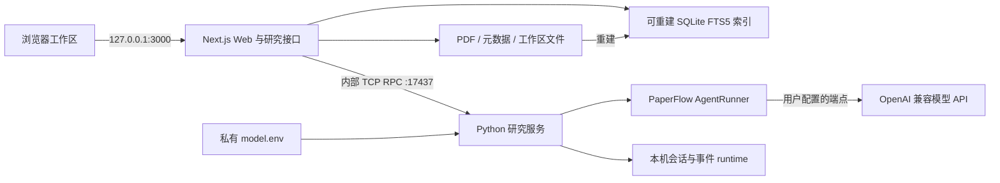

# 软件架构

基线日期：2026-11-01。公开源码保留现有 `app/` 与 `services/` 边界，使用根目录 Docker Compose 启动。

## 1. 总体结构

浏览器通过 Web 接口访问工作区。Web 服务负责文件、来源校验、检索、笔记与图谱持久化；Python 接收经过范围选择的资料并执行模型任务，保存任务会话和事件。Python 容器未挂载论文数据目录，由 Web 提供本轮可用的来源文本。

## 2. 目录与职责

| 课程逻辑分层 | 实际目录 | 职责 |
| --- | --- | --- |
| `code/frontend` | [app/src/components/research](../../app/src/components/research)、[app/src/app/workspace](../../app/src/app/workspace) | 中文工作区、PDF 阅读批注交互、笔记与复习界面、Cytoscape 图谱。 |
| `code/backend` | [app/src/app/api/research](../../app/src/app/api/research)、[app/src/lib/research](../../app/src/lib/research) | Next.js 路由、参数校验、持久化、来源范围、检索与 RPC 客户端。 |
| `code/core_engine` | [services](../../services)、[services/paperflow/src/paperflow/core](../../services/paperflow/src/paperflow/core) | Python 研究服务、限定来源工具、PaperFlow AgentRunner、权限、模型 provider 与会话。 |

逻辑分层通过目录映射呈现，运行目录保持不变；Next.js 的界面与服务端代码共享 `app/` 工程。

## 3. 数据设计

| 位置 | 内容与性质 |
| --- | --- |
| `data/papers/` | 可阅读、可导出的 PDF，包含已保存批注。 |
| `data/library/` | 论文元数据、提取正文、逐页文本及正文身份信息。 |
| `data/research/workspace.json` | 笔记及版本、概念、图谱、批注记录、复习与待办等工作区数据。 |
| `data/research/runs/` | Web 任务记录与 Python 会话的关联。 |
| `data/index.db` | SQLite 全文索引，由文件重建，无需外部数据库服务。 |
| `runtime/research/` | Python 研究任务、会话和事件。 |
| `private/model.env` | 使用者本机模型配置；不纳入公开源码。 |

文件是事实来源，SQLite 是查询索引。批注写入以 PDF ETag 检查文件版本；论文正文有独立的内容版本，笔记和图谱来源使用该版本判断证据是否仍适用。工作区写入采用文件锁、临时文件与原子替换，版本检查拒绝过期窗口覆盖新修改。

核心实体包括论文、页文本、来源引用、批注、研究笔记、概念、图谱边、研究任务、复习题组与待办。引用串联论文标识、页码、摘录与正文版本；笔记确认和图谱确认分别保留读者判断。

## 4. 关键数据流

1. **导入**：Web 接收 PDF，保存元数据、逐页正文与身份信息，再重建或更新全文索引；该流程不调用模型。
2. **阅读批注**：浏览器提交选区和评论，Web 校验 PDF 与记录版本，保存实际 PDF 标记及工作区记录；失败操作可重试。
3. **模型任务**：Web 按用户选定材料构建上下文，经 provider 适配与 TCP RPC 启动任务；Python 用 AgentRunner 执行，Web 读取状态并向界面更新结果。
4. **成果确认**：生成内容先作为草稿或候选展示；笔记由用户编辑保存，图谱摘录经原文校验后由用户确认或拒绝。
5. **导出备份**：成果导出供阅读与继续整理；完整服务备份统一保存 `data` 与 `runtime`，恢复后另行配置模型凭据。

研究 RPC 包括 `research.start`、`research.status`、`research.cancel`、`research.permission`、`research.history` 与 `research.health`。客户端实现见 [research-provider.ts](../../app/src/lib/agent/research-provider.ts)，服务端见 [research_service.py](../../services/research_service.py)。

## 5. 部署边界

- 从根目录的 [docker-compose.yml](../../docker-compose.yml)构建并启动 `web` 与 `paperflow`，访问 [本机工作区](http://127.0.0.1:3000/workspace)。
- `web` 仅将 3000 端口绑定到宿主机回环地址；17437 仅用于服务间通信，不映射到宿主机。
- 使用者配置自己的 OpenAI 兼容 API 端点、模型和密钥。模型调用会把本轮选择的资料发送至该端点。
- `data`、`runtime` 与 `private` 独立于源码；停止容器后保留这些目录。第三方代码及许可证随对应源码保留。

详细启动入口以[项目 README](../../README.md)为准，检索和图谱算法见[技术调研](../algorithm/research.md)。
