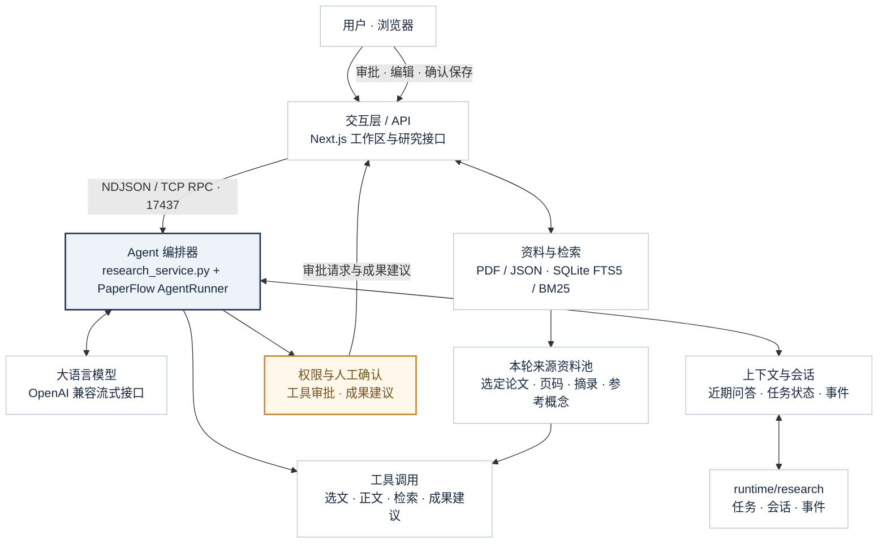
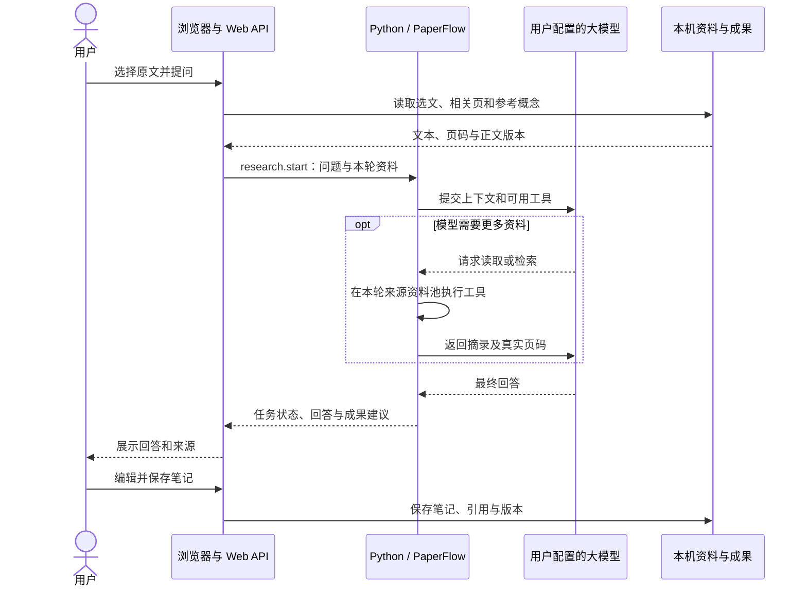

# 教研阅记技术架构

更新日期：2026-11-05。部署入口为根目录 Docker Compose，浏览器入口为 `/workspace`。

教研阅记基于 Papernook 文献阅读能力与 PaperFlow 智能体核心，串联论文管理、阅读批注、智能问答、研究笔记和知识图谱。Web 管理资料与成果，Python 服务组织模型任务，两者通过内部 RPC 协作。

## 1. AI Agent 总体架构



Web 从本机资料中选择本轮来源，将文本和来源信息交给 Python。AgentRunner 调用模型，根据模型返回的工具请求读取资料或提出成果建议，再继续生成回答。回答、任务状态和审批请求经 Web 呈现，笔记、批注和图谱由 Web 保存。

## 2. 技术分层与职责

| 层级 | 主要职责 | 本项目技术 |
| --- | --- | --- |
| 前端交互层 | 文献管理、阅读批注、笔记复习、知识图谱、成果导出 | Next.js 16.4.3、React 19、TypeScript；PDF.js、pdf-lib；KaTeX；Cytoscape.js / fCoSE |
| API 层 | 页面与接口路由、参数校验、来源范围、版本检查、RPC 转发 | Next.js Route Handlers、Zod、TCP RPC 客户端 |
| Agent 层 | 提示词、工具注册与调用、任务编排、权限审批、会话记录 | Python 3.12、PaperFlow AgentRunner、ToolRegistry、PermissionManager、SessionStore |
| 模型层 | 流式生成、工具调用协议、用量事件和错误处理 | PaperFlow provider 适配；本项目部署使用 OpenAI 兼容 Chat Completions |
| 数据层 | 论文、元数据、正文、笔记、批注、图谱、全文检索 | PDF / JSON 文件、better-sqlite3、SQLite FTS5 / BM25、页级关键词检索 |
| 基础设施层 | 服务编排、健康检查、日志、备份和恢复 | Docker Compose 双服务、healthcheck、本机目录挂载、管理脚本 |

Papernook 提供文献库、PDF 阅读批注、文件保存与全文索引基础。PaperFlow 提供模型适配、Agent 执行循环、权限、事件和会话。中文研究工作区与研究服务将这些能力连接为论文研究流程。

## 3. 项目目录

```text
openhai/
├── docker-compose.yml                 # web + paperflow 双服务
├── private/model.env                  # 使用者本机模型配置，Git 忽略
├── app/                               # Next.js 界面与业务后端
│   ├── src/app/
│   │   ├── workspace/                 # 中文主工作区
│   │   └── api/                       # research、v1 等接口
│   ├── src/components/
│   │   ├── research/                  # 文献、笔记、复习、图谱等交互
│   │   └── pdf/                       # PDF 阅读与批注组件
│   ├── src/lib/
│   │   ├── research/                  # 工作区、来源、图谱与成果逻辑
│   │   ├── library/                   # 论文文件、元数据与全文索引
│   │   ├── agent/research-provider.ts # Web 研究服务适配
│   │   └── paperflow/transport.ts     # NDJSON TCP RPC 客户端
│   └── tests/                         # Vitest 与 Playwright 测试
├── services/
│   ├── research_service.py            # 研究 RPC、任务、工具与审批
│   ├── research_context.py            # 来源页读取、检索与对话上下文
│   ├── paperflow/src/paperflow/core/
│   │   ├── runner.py                  # AgentRunner 模型—工具执行循环
│   │   ├── llm/                       # provider 与流式模型客户端
│   │   ├── tools/                     # 工具接口及注册
│   │   ├── permissions/               # 权限策略与审批
│   │   └── session/                   # 会话模型与存储
│   └── tests/                         # Python 服务测试
├── scripts/                           # 初始化、启动、检查、备份恢复
├── docs/                              # 需求、算法、架构与项目管理
├── examples/                          # 原创合成测试论文
├── data/                              # PDF、正文、工作区与检索索引
└── runtime/                           # 任务、会话、事件和启动日志
```

课程的 `code/frontend`、`code/backend`、`code/core_engine` 分别对应 `app/src/components` 与页面、`app/src/app/api` 与业务库、`services` 与 PaperFlow 核心。

## 4. Agent 的五项协作能力

### 4.1 模型调用

研究服务通过 [provider.py](../../services/paperflow/src/paperflow/core/llm/provider.py) 构造模型客户端。OpenAI 兼容路径由 [openai_provider.py](../../services/paperflow/src/paperflow/core/llm/openai_provider.py) 处理流式回答与工具调用，使用者配置自己的接口地址、模型 ID 和令牌。

### 4.2 工具调用

[research_service.py](../../services/research_service.py) 中的 `ResearchRunner` 继承 `AgentRunner`，注册下列研究工具：

| 工具 | 功能 |
| --- | --- |
| `read_selection` | 读取本轮选文及来源信息 |
| `read_paper_text` | 按论文、页码或字符范围读取本轮正文 |
| `search_paper_text` | 在本轮来源页中查找关键词和相关片段 |
| `create_note` | 提出包含题名、正文和引用的研究笔记草稿 |
| `propose_annotation` | 提出批注建议，交给 Web 展示与确认 |

四个基础工具始终注册；`search_paper_text` 在提供来源资料池或使用讨论模式时注册。工具读取范围由本轮传入的资料决定。

### 4.3 检索增强与资料组织

- **Web 全文检索**：[index-db.ts](../../app/src/lib/library/index-db.ts) 用 SQLite FTS5 建立论文和正文分块索引，以 BM25 排序；研究工作区补充逐页中文匹配并合并结果。
- **Agent 资料检索**：[research_context.py](../../services/research_context.py) 在本轮来源页中做关键词匹配，返回摘录、页码和回跳链接。
- **上下文准备**：Web 结合选文、相关正文和参考概念构建上下文；模型按需使用工具继续读取所选资料。

论文与正文保存在本机文件中，索引可重建。上述检索和读取为模型提供可引用的论文材料。

### 4.4 对话上下文与持续保存

近期问答作为后续讨论的上下文；PaperFlow 会话及研究任务事件保存在 `runtime/research/`。论文、笔记、概念、图谱和历史版本保存在 `data/`，由 Web 按用户选择组成后续任务材料。资料范围变更时更新会话上下文，保持回答与所选来源对应。

### 4.5 权限、证据与人工确认

`PermissionManager` 按工具策略处理调用：读取工具自动执行，`create_note` 请求审批，等待窗口为 120 秒。笔记及批注工具生成待确认建议，具体文件由 Web 写入。

图谱任务生成概念、关系、页码和摘录；Web 核对指定页的原文及正文版本，将关系作为候选交给用户确认。运行状态、模型用量和工具事件随任务记录保存。

## 5. 一次选文问答的数据流



论文导入在 Web 中完成 PDF 保存、元数据与逐页正文提取，再更新全文索引。阅读批注同时关联 PDF 标记和工作区记录。图谱生成沿用“分析材料 → 提取概念与关系 → 原文校验 → 用户确认 → 保存展示”的流程。

## 6. 数据保存与本地部署

| 路径 | 保存内容 |
| --- | --- |
| `data/papers/` | 论文 PDF 与已保存的 PDF 批注 |
| `data/library/` | 论文元数据、正文、逐页文本与内容版本 |
| `data/research/workspace.json` | 笔记及版本、批注记录、概念、图谱、复习和待办 |
| `data/research/runs/` | Web 任务与 Python 会话的关联 |
| `data/index.db` | 可重建的 SQLite 全文检索索引 |
| `runtime/research/` | Python 任务、会话、事件及运行配置 |
| `private/model.env` | 使用者自己的模型配置 |

PDF 与 JSON 文件保存原始资料和研究成果。工作区采用文件锁与原子替换，PDF 通过 ETag 检查版本；来源引用保留论文、页码、摘录与正文版本。

[Docker Compose](../../docker-compose.yml) 启动两个服务：

- `web`：Next.js 应用，默认通过 `127.0.0.1:3000` 访问。
- `paperflow`：Python 研究服务，在容器网络内监听 `17437`，通过 NDJSON TCP RPC 与 Web 通信。

宿主机安装 Docker 与 Compose；Node.js、Python 和运行依赖由镜像提供。使用者初始化数据目录、填写模型配置，再运行启动脚本。资料与会话通过本机目录挂载保存，关闭服务后继续保留；备份脚本统一备份 `data` 与 `runtime`。

详细操作见 [README](../../README.md)，检索与图谱算法见 [技术调研](../algorithm/research.md)，上游分工见 [整合说明](../../UPSTREAM.md)。
