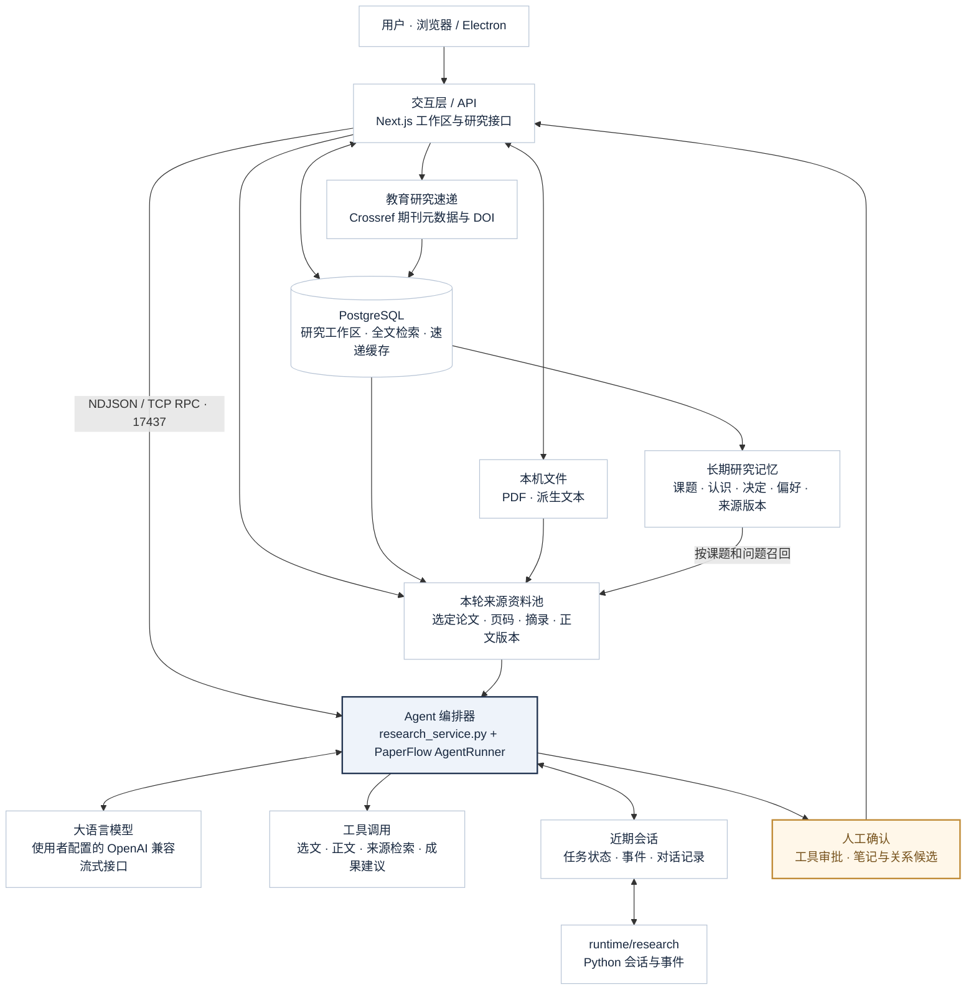
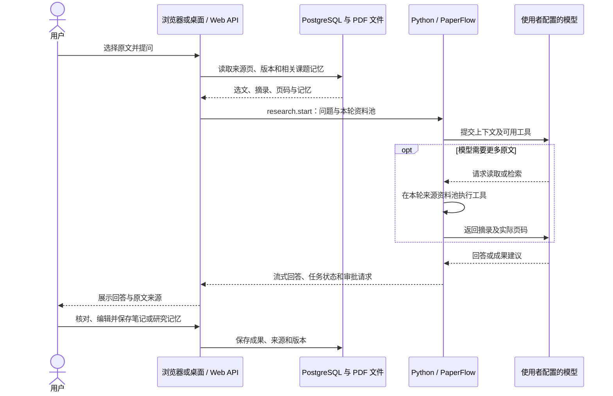

# 教研阅记技术架构

更新日期：2026-11-24。浏览器入口为 `/workspace`，Windows 桌面入口为 Electron。Docker Compose 运行 **Web 与 PaperFlow 两个服务**，研究业务数据库使用宿主机 PostgreSQL。

教研阅记连接文献管理、原文批注、智能问答、笔记复习、研究记忆与多文献关系。Web 管理资料、来源范围与研究成果，Python / PaperFlow 组织模型任务，两者通过内部 RPC 协作。模型接口和数据库由使用者在自己的电脑配置。

## 1. 总体架构



Web 从本机资料中选择本轮来源，组合相关研究记忆，将文本、页码和来源版本交给 Python。AgentRunner 根据问题调用模型，按需读取或检索本轮资料。回答、审批请求和成果建议经 Web 展示，由用户核对和确认保存。

## 2. 技术分层与职责

| 层级 | 主要职责 | 本项目技术 |
| --- | --- | --- |
| 前端交互层 | 文献、阅读批注、笔记公式、复习、图谱与导出 | Next.js 16.4.3、React 19、TypeScript；PDF.js、pdf-lib；KaTeX；Cytoscape.js / fCoSE |
| 桌面入口层 | 独立窗口、本机连接、启动与退出、文件选择及导出 | Electron 45.3.2、Node.js 24.22.3、本地 PowerShell 启动器 |
| API 层 | 路由、参数与版本校验、来源范围、RPC 转发 | Next.js Route Handlers、Zod、NDJSON TCP RPC 客户端 |
| Agent 层 | 提示词、模型—工具循环、审批、任务事件与会话 | Python 3.12、PaperFlow AgentRunner、ToolRegistry、PermissionManager、SessionStore；Pydantic |
| 模型层 | 流式回答、工具调用、用量事件及错误处理 | PaperFlow provider 适配；当前部署接入 OpenAI 兼容 Chat Completions |
| 数据层 | 研究工作区、论文页、笔记版本、图谱、记忆、全文检索与速递缓存 | PostgreSQL、`pg` 驱动、JSONB、事务和版本检查、`tsvector` / GIN、`ts_rank_cd` 与原文匹配 |
| 基础设施层 | 容器编排、健康检查、本机持久化、日志及恢复 | Docker Compose 双服务、宿主机 PostgreSQL、`pg_dump` / `pg_restore`、管理脚本 |

Papernook 提供文献阅读、PDF 批注与文件保存基础；PaperFlow 提供模型适配、Agent 执行循环、权限、事件及会话。中文研究工作区连接这些能力，并增加研究记忆、多文献比较和教育期刊速递。上游兼容模块仍保留部分 SQLite 依赖；当前研究工作区的主存储和全文检索使用 PostgreSQL。

## 3. 项目目录

```text
openhai/
├── docker-compose.yml                 # web + paperflow 双服务
├── private.example.env                # 空白模型配置模板
├── private.postgres.example.env       # 空白数据库连接模板
├── private/                           # 使用者本机配置，Git 忽略
│   ├── model.env
│   └── postgres.env
├── app/                               # Next.js 界面、API 与业务逻辑
│   ├── src/app/workspace/             # 中文主工作区
│   ├── src/app/api/                   # research、v1 等接口
│   ├── src/components/research/       # 文献、笔记、复习、图谱等交互
│   ├── src/components/pdf/            # PDF 画布、文字层与批注
│   ├── src/lib/research/
│   │   ├── postgres/                 # 连接、建表、工作区、检索与迁移
│   │   ├── memory/                   # 课题记忆、来源版本与召回
│   │   ├── relations/                # 多文献对照、关系及概念合并
│   │   └── discovery/                # 期刊来源、目录、导读与缓存
│   └── tests/                         # Vitest 与 Playwright
├── services/
│   ├── research_service.py            # 研究 RPC、任务、工具与审批
│   ├── research_context.py            # 来源页读取、检索与讨论上下文
│   ├── research_metadata.py           # 可选模型文献信息提取
│   ├── research_discovery.py          # 检索计划与中文导读模型任务
│   ├── paperflow/src/paperflow/core/  # runner、llm、tools、permissions、session
│   └── tests/                         # Python 服务测试
├── desktop/                           # Electron 源码、初始化与打包脚本
├── scripts/                           # 初始化、启动、检查、备份与恢复
├── docs/                              # 需求、算法、架构、使用与项目管理
├── examples/                          # 原创合成测试论文
├── data/                              # 使用者 PDF、正文与兼容文件，Git 忽略
└── runtime/                           # 使用者任务、会话、事件和日志，Git 忽略
```

PostgreSQL 的程序和活动数据由使用者的本机安装管理，公共仓库不分发数据库目录。课程模板中的 `code/frontend`、`code/backend`、`code/core_engine` 对应 `app/`、API 与业务库、`services/` 及 PaperFlow 核心。

## 4. Agent 协作、记忆与证据

### 模型和工具

[research_service.py](../../services/research_service.py) 中 `ResearchRunner` 继承 PaperFlow `AgentRunner`。模型客户端由 provider 适配构造，使用者提供自己的接口地址、模型 ID 和令牌。

| 工具 | 功能 |
| --- | --- |
| `read_selection` | 读取本轮选文和来源信息 |
| `read_paper_text` | 按来源论文、页码或字符范围继续读取正文 |
| `search_paper_text` | 在本轮来源页中匹配关键词，返回摘录、页码和回跳链接 |
| `create_note` | 提出含题名、正文及引用的笔记草稿 |
| `propose_annotation` | 提出批注建议，由 Web 展示与确认 |

四项基础工具始终注册，正文检索工具按来源资料池和讨论模式注册。资料工具的范围受本轮传入材料约束。`PermissionManager` 对 `create_note` 请求审批，等待窗口为 120 秒；成果写入由 Web 统一处理。

### 近期会话与长期研究记忆

近期问答、任务状态和工具事件由 PaperFlow 会话与 `runtime/research/` 保留。长期记忆由 [memory/](../../app/src/lib/research/memory) 管理，作为 PostgreSQL 工作区状态的一部分保存：

- 课题目标、关键认识、决定、待解决问题和回复偏好可显式编辑、删除。
- 记忆关联论文、笔记或批注，记录正文及来源版本；来源删除、回收或改变时检查其有效性。
- 问答前按课题、问题与当前可见材料召回相关记忆，组合进本轮上下文。
- 课题进展整理保留来源与版本信息，用户可核对和修改。

记忆召回在本机执行，无需向量数据库或额外付费记忆服务。回答仍基于本轮来源范围，研究记忆帮助延续已经保存的研究认识。

### 检索与多文献关系

[PostgreSQL 检索](../../app/src/lib/research/postgres/search.ts) 使用 `tsvector` / GIN 索引、`websearch_to_tsquery` 和相关度排序，并补充中英文原文匹配。Python 的 [research_context.py](../../services/research_context.py) 在本轮来源页中做关键词检索，为模型返回可引用片段。

[relations/](../../app/src/lib/research/relations) 对 2–4 篇选定论文组织研究对象、方法、发现和条件对照；关系候选保留双方原文和引用。Web 核对页码、原文摘录与内容版本，再由用户确认或拒绝。图谱支持按论文、课题、关系和年份查看，提供时间线、布局保存、概念合并及撤销。确认后的关系与来源一起保存在 PostgreSQL。

### 教育研究速递

[discovery/](../../app/src/lib/research/discovery) 查询四种期刊的 Crossref 公开元数据，以在线发表日期组织近期目录；原摘要和 DOI 链接用于访问来源。模型可按需生成检索计划和中文导读。目录、导读与待读标记保存在 PostgreSQL，并有刷新租约、条数及响应大小限制，减少重复请求和常驻内存。

## 5. 一次选文问答的数据流



导入论文时，Web 保存 PDF、提取逐页原文并更新 PostgreSQL；模型元数据提取为可选步骤。阅读批注同时关联 PDF 标记与工作区记录。图谱关系沿用“选材料 → 分析 → 原文校验 → 用户确认 → 保存”的流程。

## 6. 持久化、部署与退出

| 组件或位置 | 保存内容 |
| --- | --- |
| PostgreSQL `jiaoyan` | 论文、页级正文、笔记版本、批注、图谱、复习、待办、研究记忆与任务状态 |
| PostgreSQL 速递表 | 教育期刊目录、中文导读与待读状态 |
| `data/papers/` | PDF 与已写回的标准 PDF 批注 |
| `data/library/` | 派生文本、内容身份及兼容文件 |
| `runtime/research/` | Python / PaperFlow 会话与事件 |
| `private/` | 使用者的模型与数据库连接配置 |
| `desktop/.local/` | 桌面浏览器资料、未提交草稿、下载和本地日志 |

Web 首次连接数据库时自动创建表、索引和迁移标记。工作区写入结合数据库事务与版本检查；PDF 保存继续通过 ETag 核对文件版本。旧 JSON 工作区可首次导入，迁移后的研究工作区由 PostgreSQL 提供读写和检索。

[Compose](../../docker-compose.yml) 中 `web` 默认通过本机 `127.0.0.1:3000` 提供页面；`paperflow` 在容器网络监听 `17437`。Web 使用 `host.docker.internal` 连接使用者自己的 PostgreSQL，数据库端口来自 `private/postgres.env`。Python 与 Node.js 应用依赖由镜像提供。

Windows 桌面端复用相同工作区，通过本地启动器管理本项目。正常关闭先处理未保存确认，再等待启动操作结束，停止本项目容器并退出；普通 PostgreSQL 系统服务和 Docker Desktop 保持运行。便携部署的专用数据库由其专用脚本随项目管理，公共源码不附带开发者的便携数据或配置。

完整备份将 `pg_dump` 数据库逻辑快照与对应的 `data/`、`runtime/` 一起保留；恢复前校验并保存现有状态。网页成果 ZIP 用于分享可见研究成果。模型配置、数据库配置、个人数据、浏览器草稿和服务日志均在本机保管。

## 7. 验证与文档范围

本页按当前源码、依赖版本和部署入口整理；历史 [验收记录](validation.md) 保留当时版本和实际运行日期。新环境应执行初始化、数据库连接检查、镜像构建和功能验收。修改架构后同步更新本页与部署说明。

快速开始见 [README](../../README.md)，数据库创建及连接见 [PostgreSQL 部署](../PostgreSQL部署.md)，上游分工和许可见 [UPSTREAM](../../UPSTREAM.md)。