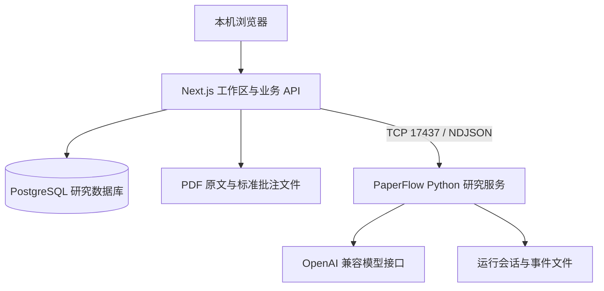
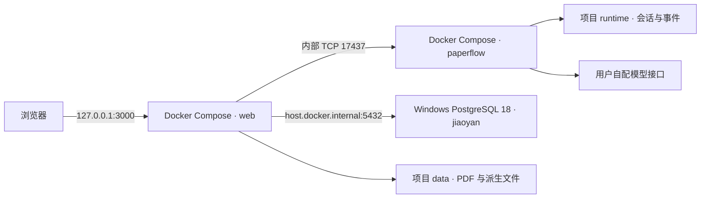
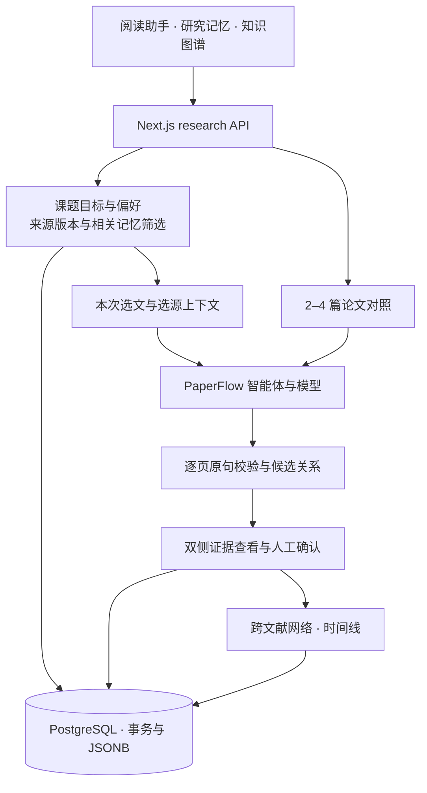

# 教研阅记：技术架构与本地部署

汇报日期：2026年11月1日；数据库架构更新：2026年11月8日；研究记忆与文献关系更新：2026年11月13日

本文保留课程汇报结构，路径已改为通用示例。`assets/` 中的静态架构图为早期部署示意；当前架构与安装步骤以 [软件架构](../software/architecture.md) 和 [PostgreSQL 本机部署](../PostgreSQL部署.md) 为准。

## 1. 项目定位

教研阅记面向论文阅读与研究资料整理，将文献管理、PDF 批注、AI 讨论、研究笔记、学习复习、课题记忆和多文献知识图谱整合为一个 Web 工作台。

**功能闭环：论文导入 → 阅读批注 → 选文讨论 → 笔记沉淀 → 知识关联 → 成果导出。**

## 2. 总体技术架构



系统采用浏览器与服务端协同的 B/S 架构。Next.js 承担界面与业务接口，Python 研究服务复用 PaperFlow 执行 AI 任务，模型调用由使用者自行配置的 OpenAI 兼容接口提供。

| 技术模块    | 主要技术                                                  | 实现内容                                                                       |
| ----------- | --------------------------------------------------------- | ------------------------------------------------------------------------------ |
| Web 应用    | Next.js 16、React 19、TypeScript、Node.js 22              | 论文管理、阅读交互、笔记编辑和业务 API                                         |
| PDF 处理    | PDF.js、pdf-lib、Poppler                                  | 页面渲染、选区定位、标准批注写入和逐页文字提取                                 |
| 业务数据    | PostgreSQL 18、关系表、JSONB、事务                        | 论文信息、逐页正文、笔记及版本、批注记录、概念、图谱、复习、待办和网页研究任务 |
| 资料检索    | PostgreSQL 全文检索、GIN 索引、相关度排序与中英文原文匹配 | 论文标题与逐页正文检索，结合工作区笔记、批注和概念匹配                         |
| AI 任务执行 | Python 3.12、PaperFlow                                    | 模型调用、工具调用、会话管理和任务状态管理                                     |
| 课题记忆    | TypeScript、来源版本校验、上下文范围哈希                  | 课题目标、回复偏好、显式记忆、相关条目召回与进展整理                           |
| 知识图谱    | Cytoscape.js、fcose、PaperFlow 文献对照                   | 论文、概念、笔记网络，跨文献关系、双侧证据、概念合并与时间线                   |

### 开源复用与整合

| 组成                                                                                               | 复用与扩展                                                                 |
| -------------------------------------------------------------------------------------------------- | -------------------------------------------------------------------------- |
| [Papernook](https://github.com/affromero/papernook/tree/4f36454eb73f85450882d35519aa41701aca5b39)  | 复用文献库、PDF 阅读器、批注保存、全文索引和图谱组件                       |
| [PaperFlow](https://github.com/weijian-ai/PaperFlow/tree/500baf5a404f6f00133a3280b2cf40d178c63cf7) | 复用 AgentRunner、模型连接、工具注册和 SessionStore 会话存储               |
| 教研阅记整合层                                                                                     | 构建中文研究工作区，组织选文与参考概念，串联讨论、笔记、复习和关系确认流程 |

Papernook 与 PaperFlow 均采用 MIT 许可，项目保留上游版权与第三方许可文件。

## 3. 核心业务流程

| 场景           | 处理流程                                                                              | 形成的成果                                   |
| -------------- | ------------------------------------------------------------------------------------- | -------------------------------------------- |
| 论文导入与阅读 | 上传 PDF → 提取元数据与逐页正文 → 建立检索索引 → 阅读与标记                           | 文献条目、阅读位置、高亮与个人想法           |
| 选文讨论与笔记 | 选择原文并提问 → 组织参考概念和相关段落 → PaperFlow 调用模型及检索工具 → 编辑保存回答 | 带来源页码的 Markdown 笔记、连续讨论记录     |
| 研究记忆       | 建立课题与目标 → 记住回答或笔记 → 按本次选源与问题召回 → 整理研究进展                 | 跨会话延续的课题目标、认识、决定和待解决问题 |
| 知识图谱       | 概念匹配或 AI 提取 → 对应页摘录校验 → 多文献对照 → 用户确认关系                       | 可回看双方原文的论文—概念—笔记网络           |
| 学习复习       | 选择论文、选文或笔记 → 生成题组 → 逐题作答与自评 → 记录复习进度                       | 自测题组与个人学习记录                       |

PaperFlow 接收 Web 应用组织的研究上下文，通过选文读取、论文检索和模型调用完成问答、精读卡、笔记草稿及图谱候选关系生成。Web 应用负责结果展示、PDF 批注写入，并将笔记、图谱及网页研究任务记录保存到 PostgreSQL。Python 执行会话和原始事件保存在 `runtime/research/`。

## 4. 部署结构



运行环境为 Windows、PostgreSQL 18、Docker Desktop（WSL2 / Linux 容器）和浏览器。PostgreSQL 作为 Windows 系统服务运行，Docker Compose 编排 Web 与 PaperFlow 两个应用服务，本机目录通过卷挂载保存 PDF 与运行会话。

| 服务        | 运行环境             | 访问与通信                                        | 数据目录                |
| ----------- | -------------------- | ------------------------------------------------- | ----------------------- |
| `web`       | Node.js 22 / Next.js | 本机浏览器访问 `127.0.0.1:3000`                   | `data/`、`examples/`    |
| `paperflow` | Python 3.12          | Compose 内部 TCP `17437`，逐行 JSON-RPC（NDJSON） | `runtime/`、`private/`  |
| PostgreSQL  | Windows 本机服务     | 专用数据库 `jiaoyan`，端口 `5432`                 | `<PostgreSQL安装目录>\data` |

**应用入口：** <http://127.0.0.1:3000/workspace>

**模型连接：** 使用者在本机 `private/model.env` 中填写自己的 OpenAI 兼容接口、模型 ID 与访问令牌。令牌仅在本机保管，接口额度与使用条件由使用者选择的服务商提供。

### 部署与日常运行

项目目录：`.\openhai`

先启动 PostgreSQL 系统服务与 Docker Desktop，再构建并启动应用。数据库连接配置位于 `private/postgres.env`。

```powershell
cd ".\openhai"
docker compose build
docker compose up -d --no-build
```

| 操作           | 入口                                          |
| -------------- | --------------------------------------------- |
| 打开应用       | `打开教研阅记.cmd`（桌面，首次先安装桌面依赖），或 `启动Demo.cmd`（浏览器） |
| 关闭应用       | 关闭桌面窗口并等待自动停止；浏览器部署使用 `停止Demo.cmd` |
| 查看运行状态   | `检查Demo.cmd`                                |
| 更新代码后重建 | `重新构建.cmd`                                |
| 生成资料快照   | `备份Demo.cmd`                                |
| 恢复资料快照   | `恢复备份.cmd`                                |

启动器依次完成数据库连接检查、Docker 就绪检查、服务启动和工作区响应检查，再打开浏览器。完整备份使用 `pg_dump`，将数据库与 PDF、运行会话一同打包保存。

## 5. 数据组织

```text
openhai/
├─ app/                         Web 界面与业务接口
├─ services/                    PaperFlow 核心与 Python 研究服务
├─ data/
│  ├─ papers/                   PDF 原文及标准批注
│  └─ library/                  派生文本、身份信息与兼容文件
├─ runtime/                     Python 会话、执行事件与启动日志
├─ private/model.env            模型连接配置
├─ private/postgres.env         数据库连接配置
├─ backups/                     资料与会话快照
├─ scripts/                     启停、构建与备份脚本
└─ docker-compose.yml           双服务编排配置
```

PostgreSQL 数据库文件位于 `<PostgreSQL安装目录>\data`。关系表保存论文、逐页正文、笔记及版本、批注记录、概念、图谱节点与关系、复习、待办及网页研究任务；JSONB 保存业务对象字段，GIN 索引支持全文检索。笔记正文采用 Markdown。

课题、记忆条目、回复偏好、文献对照和概念合并记录沿用 `research_workspace.metadata` JSONB 存储；节点、关系与任务记录继续使用现有业务表。更新通过现有事务与版本校验完成，纳入数据库备份。

PDF 与标准批注继续保存为文件；Python 会话、执行事件和启动日志继续保存于 `runtime/`。旧 `workspace.json`、`research/runs/` 与 SQLite 文件保留为迁移前资料，当前业务读写、页正文与全文检索使用 PostgreSQL。论文页码与原文摘录连接批注、笔记和图谱关系，形成可回溯的资料组织结构。

## 6. 课题记忆与多文献关系



**记忆路径：** 用户建立课题、编辑研究问题与全局回复偏好，将回答或笔记中的关键内容显式保存为“研究认识、研究决定、待解决问题”。每轮提问按课题、本次资料范围、来源版本和相关度挑选记忆，最多 8 条、正文合计最多 5000 字符。记忆内容与课题范围进入会话哈希，变更后新请求重新建立匹配上下文；回答保存当轮记忆快照。来源论文、笔记或批注变化后，相关旧记忆退出新一轮召回。

**进展路径：** “整理进展”在本机组织已保存的研究认识、决定、已确认笔记标题和待解决问题，结果可人工编辑。整体进展按来源版本记录有效性，并在该课题全部论文被选中时参与讨论。

**关系路径：** 已有论文—概念证据汇总出共享概念与方法联系；显式“文献对照”调用模型比较 2–4 篇所选论文，形成研究对象、方法、发现与适用条件对照表，并生成带双方原句的关系候选。对照任务独立使用所选论文，结果核验后进入图谱，由用户确认或拒绝。完整题名匹配在参考文献区形成引用候选；概念合并保留别名、来源和关系，并保存可撤销快照。

新增功能复用现有 Next.js、React、Cytoscape.js、PaperFlow、PostgreSQL 和 `pg`，新增依赖数为 0。编辑与本地整理直接运行；AI 问答、提取及文献对照使用已配置模型的额度。操作说明见 [研究记忆与文献关系](../研究记忆与文献关系.md)。
