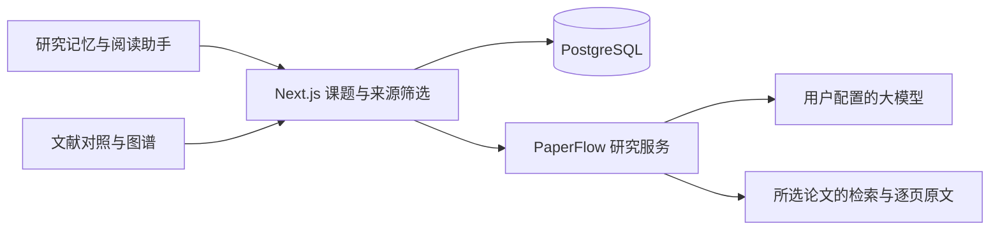

# 研究记忆与文献关系使用说明

## 1. 先建立研究课题

打开侧栏“研究记忆”。已有论文会按研究主题形成初始课题，也可点击“新建课题”。

填写“课题名称”和“研究问题”，展开“课题文献”勾选论文，点击“保存课题”。例如：课题为“课堂反馈”，研究问题为“反馈时机如何影响学生的后续学习？”

“回复偏好”适用于所有课题。例如填写“使用中文，直接解释论证，公式后补充符号含义”，再点击“保存偏好”。本轮提问中的明确要求优先。

## 2. 保存、修改和删除记忆

| 类型       | 适合保存的内容       | 例子                             |
| ---------- | -------------------- | -------------------------------- |
| 研究认识   | 已核对的观察与解释   | 反馈内容需要与具体学习任务对应   |
| 研究决定   | 后续研究沿用的选择   | 优先比较中学课堂的实证研究       |
| 待解决问题 | 下一轮继续查阅的问题 | 不同反馈时机使用了哪些测量指标？ |

有两种保存方式：

1. 在阅读助手的已完成回答或研究笔记工具区点击“记住”。在“记住这点”弹窗选择课题、类型，编辑要保留的内容，点击“保存记忆”。笔记可先保存，再将其中的关键认识加入记忆。
2. 在“研究记忆 → 课题记忆 → 添加记忆”中直接填写。

条目支持“编辑”和“删除”。来源页码可回到原文。删除后，后续提问停止调用该条记忆；之前的讨论保留当时实际使用的记忆记录。“删除课题”同时删除该课题的记忆，论文和笔记继续保留。

## 3. 在下一次讨论中继续研究

阅读助手中先选择“研究课题”，再核对“提问来源”。同一篇论文属于多个课题时，请明确选择本次课题。

每次提问会调用课题目标、全局回复偏好，以及与问题相关的有效记忆。研究决定可持续使用；提到“继续”“上次”“待解决”等内容时，会结合待解决问题。换一段选文、重新打开论文或开始下一轮讨论，都可继续使用这些已保存内容。

调用范围由本次资料选择决定：

- 关联论文的记忆，其全部来源论文都应在本次“提问来源”中。
- 课题整体进展在课题全部论文均被选中时参与讨论。
- 来源论文移入回收站、永久删除或正文更新，以及来源笔记、批注被修改后，相关旧记忆停止参与新回答。恢复原资料且版本一致时可继续使用。

展开回答旁的“本次研究记忆”，可查看本轮课题、使用的条目和偏好状态。每轮最多挑选 8 条相关记忆，并限制文字长度，以保留原文和当前问题的空间。

## 4. 整理研究进展

在课题页点击“整理进展”，系统在本机组织：研究问题、已保存的研究认识与决定、已确认笔记的标题清单，以及待解决问题。

结果显示在“研究进展”和“待解决问题”中，可直接编辑后点击“保存课题”。这一步使用本地规则组织已确认内容，不调用模型。来源发生变化后，重新核对记忆与笔记，再整理进展。

## 5. 比较多篇文献

进入“知识图谱”，点击“文献对照”：

1. 选择 2–4 篇论文，填写希望比较的问题。
2. 点击“比较所选文献”，等待任务完成；运行期间可“取消任务”。
3. 查看“研究对象 / 方法 / 主要发现 / 适用条件”对照表，点击证据页码核对原文。
4. 在“已保存的对照”中回看结果，或导出 Markdown、CSV。

文献对照调用当前配置的大模型，使用本次选中的论文。该任务独立组织原文资料，课题记忆和回复偏好不加入对照输入。每条拟入库的摘录会核对论文、正文版本、页码和原句。

## 6. 核对论文之间的关系

图谱可呈现共同涉及概念、共用研究方法、结论相近、结论存在差异及引用等联系。

- **关系证据：** 点击连线，在“关系与证据”中查看解释与原文。跨文献关系可点“并排查看证据”，同时核对双方摘录，再点击页码回到论文。
- **候选审核：** 在“待核对”中选择候选，点击“确认关系”或“拒绝”。共同概念、共同方法由已有证据关系汇总；模型比较的结论联系先保存为候选。
- **引用匹配：** 点击“匹配引用”，在论文参考文献区查找库内论文的完整题名，形成带参考条目出处的引用候选，随后核对确认。
- **重复概念：** 点击概念节点，展开“整理重复概念”，选择保留的概念后点“合并”。原名称进入别名，来源和关系随之整合。可在合并记录中点击“撤销”；撤销适用于合并后尚未继续修改图谱或概念的状态。

正文更新后，对照结果和关系会标记需要重新核对。回收站中的论文及其关联资料从当前图谱视图隐藏。

## 7. 筛选和时间线

使用“全部课题 / 全部关系 / 全部年份”、论文筛选、关键词搜索和“候选关系”开关缩小范围。

“网络”适合查看连接与邻居；“时间线”按论文年份排列文献，未填写年份的论文集中显示为“未标年”。可拖动节点、滚轮缩放，点击“适应画布”回到全貌。

## 8. 技术与本地保存

新增功能沿用现有开源代码和依赖：Papernook 与 PaperFlow 均为 MIT 许可；界面使用 Next.js、React、TypeScript，图谱使用 Cytoscape.js，数据库使用 PostgreSQL，连接使用现有 `pg`。此次扩展以项目内代码实现，新增依赖数为 0。上游版本与许可见 [UPSTREAM.md](../UPSTREAM.md)。

课题、记忆、回复偏好、文献对照和概念合并记录保存于 PostgreSQL `research_workspace.metadata` 的 JSONB 字段；图谱节点和关系沿用业务表，回答的记忆快照随研究任务保存。写入通过现有事务和版本校验完成，随数据库备份恢复。PDF 原文继续保存在项目文件目录。

手动编辑、记忆保存与召回、整理进展、筛选、引用匹配、概念合并及导出在本地完成。AI 问答、AI 图谱提取和文献对照使用当前配置接口的模型额度。
